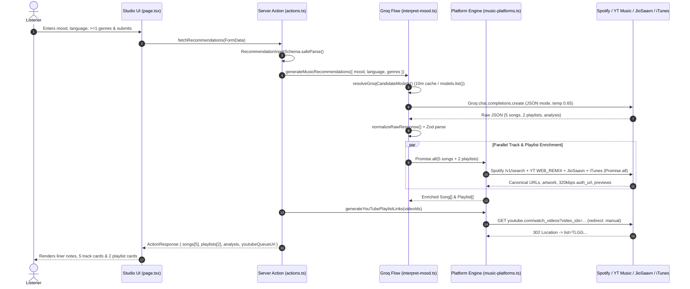
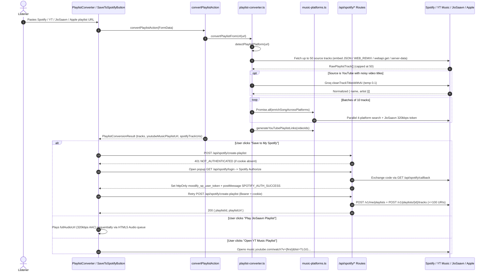
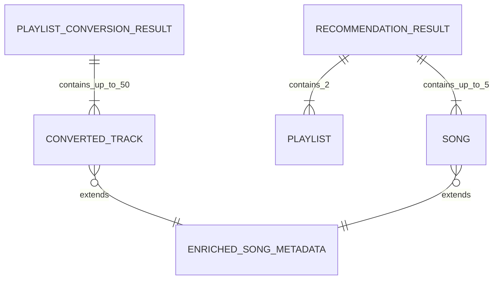

# Moodify — Architecture

---

## 1. Stack & Runtime Versions

| Layer | Technology & Exact Version | Runtime / Region / Notes |
|---|---|---|
| Framework | Next.js `^16.4.6` (App Router, Turbopack) · TypeScript `^7.0.2` | Vercel Serverless · Node.js `22.x` · `pnpm` |
| UI & Styling | React `^19.3.1` · Tailwind CSS `^3.4.19` · Radix UI (`slot ^1.5.0`, `toast ^1.3.1`) · `lucide-react ^1.72.0` · `geist ^1.9.2` | Dark studio theme (`#09090b` / `#E11D48`), responsive `320px–1440px+` |
| Validation | Zod `^4.6.7` | Server Action input & LLM structured output schemas |
| AI / LLM | Groq SDK `^1.6.0` (`openai/gpt-oss-120b` primary + 5-model fallback chain) | Server-only JSON mode, `10m` model catalog cache |
| Platform Resolvers | Spotify Web API & OAuth 2.0 · YouTube Music `WEB_REMIX` · JioSaavn API · iTunes Search API | `Promise.all` parallel lookups, `2.5s–6.5s` `AbortSignal` timeouts |
| Security & CI | `vercel.json` HTTP headers · GitHub Actions CI (`typecheck` + `build`) · CodeQL · Gitleaks · Renovate | `httpOnly` `sameSite: "lax"` OAuth cookie |

---

## 2. System Topology & Components

```mermaid
flowchart LR
  Browser[Browser Studio UI<br/>page.tsx · PlaylistConverter] -->|Server Actions| Next[Next.js 16 App Router<br/>actions.ts · converter-actions.ts]
  Browser -->|OAuth Popup & Export| SpotifyRoutes[/api/spotify/*<br/>login · callback · create-playlist]
  Next -->|JSON Mode + models.list| Groq[Groq Cloud API]
  Next -->|Parallel Catalog Lookup| SpotifyAPI[Spotify Web API<br/>client_credentials]
  Next -->|WEB_REMIX JSON + watch_videos| YTMusic[YouTube Music API]
  Next -->|search.getResults + generateAuthToken| JioSaavn[JioSaavn API<br/>320kbps AAC]
  Next -->|iTunes Song Search| Apple[iTunes Search API]
  SpotifyRoutes -->|Authorization Code + Playlist Write| SpotifyAPI
```

```text
src/
  app/
    page.tsx                            Main studio UI (Mood Curation + Playlist Exporter + Spotify dock)
    layout.tsx                          Root layout, Geist fonts, JSON-LD WebApplication schema, OpenGraph metadata
    globals.css                         Dark studio theme tokens, splash/wave/fade animations
    opengraph-image.tsx                 Dynamic 1200x630 OpenGraph PNG card
    twitter-image.tsx                   Re-exported 1200x630 Twitter card
    robots.ts                           Crawler rules (/robots.txt, disallows /api/)
    sitemap.ts                          XML sitemap (/sitemap.xml)
    manifest.ts                         PWA web manifest (/manifest.webmanifest)
    icon.svg                            Vector brand icon
    actions.ts                          Server Action: fetchRecommendations (Zod input -> AI -> 4-platform enrichment -> TLGG link)
    converter-actions.ts                Server Action: convertPlaylistAction (URL -> import -> AI clean -> batch enrich)
    api/spotify/
      login/route.ts                    GET: Redirects popup to accounts.spotify.com/authorize
      callback/route.ts                 GET: Exchanges auth code, sets httpOnly cookie, posts result to window.opener
      create-playlist/route.ts          POST: Creates private Spotify playlist & inserts up to 100 track URIs
  ai/flows/
    interpret-mood.ts                   Mood curation prompt, response normalizer, Zod schemas & enrichment wiring
  types/
    music.ts                            Canonical TypeScript interfaces (Song, Playlist, PlaylistConversionResult, ActionResponse)
  lib/
    groq.ts                             Server-only Groq client factory, 10-min model cache, JSON extractor & retry predicate
    music-platforms.ts                  Parallel exact-link & stream resolver (Spotify, YT Music, JioSaavn, iTunes) + watch_videos
    playlist-converter.ts               Playlist importers (Spotify embed, YT Music, JioSaavn, Apple Music) + AI title cleaner
    utils.ts                            cn(), AUDIO_SYNC_EVENT broadcaster, HTML entity decoder, artist extractor, duration formatter
  components/
    genre-selector.tsx                  Searchable 126-genre tag selector with selected counter
    llm-recommendation-card.tsx         Responsive song card with sleeve audio preview & exact platform buttons
    llm-playlist-card.tsx               Playlist card with inline Spotify iframe toggle & exact links
    playlist-converter.tsx              Cross-platform playlist exporter & JioSaavn 320kbps continuous queue player
    save-to-spotify-button.tsx          OAuth popup lifecycle coordinator & playlist creation trigger
    splash-screen.tsx                   3.2s animated splash screen (fade-out 550ms)
    loading-animation.tsx               5-bar equalizer wave loading indicator
    footer.tsx                          Product footer
    ui/                                 Domain-agnostic primitives (alert, button, input, textarea, toast, toaster)
  hooks/
    use-toast.ts                        Toast notification queue hook
  config/
    genres.ts                           126 genre slugs
```

### Component Boundaries
- **UI Layer (`src/app/page.tsx`, `src/components/*`):** Manages local form state, tab switching (`curate` vs `converter`), synchronized audio playback via `moodify:audio-play`, and Spotify OAuth popup messaging. Never holds API keys or performs direct upstream catalog fetches.
- **Action & Route Boundary (`src/app/actions.ts`, `converter-actions.ts`, `api/spotify/*`):** Validates client payloads, invokes server-only orchestrators, manages OAuth cookies, and maps exceptions into typed JSON/action responses.
- **Orchestration & Platform Layer (`src/ai/flows/*`, `src/lib/*`):** Marked `"use server"` / `"server-only"`. Handles Groq fallback chains, 4-platform parallel enrichment, playlist scraping/parsing, and `TLGG` playlist ID resolution.

---

## 3. End-to-End Request Flows

### 3.1 Mood Curation Flow



### 3.2 Cross-Platform Playlist Conversion & Export Flow



---

## 4. Domain Model & Data Contracts (Stateless)

Moodify operates **without a database**. All state flows through typed payloads defined in `src/types/music.ts`:



| Interface (`src/types/music.ts`) | Key Fields | Constraints / Notes |
|---|---|---|
| `EnrichedSongMetadata` | `artworkUrl`, `previewUrl`, `fullAudioUrl`, `album`, `releaseYear`, `youtubeVideoId`, `youtubeMusicUrl`, `youtubeUrl`, `jioSaavnUrl`, `spotifyTrackId`, `spotifyUrl`, `appleMusicUrl` | Populated in parallel by `enrichSongAcrossPlatforms`; artwork priority `Spotify -> iTunes -> JioSaavn -> YouTube`; audio priority `JioSaavn 320kbps -> iTunes 30s -> Spotify preview -> JioSaavn vlink` |
| `Song` | `name`, `artist`, `note?` + `EnrichedSongMetadata` | Validated `1..5` items by `GenerateMusicRecommendationsOutputSchema` |
| `Playlist` | `name`, `description` + `EnrichedPlaylistMetadata` | Validated `1..2` items (`youtubePlaylistId`, `youtubeMusicUrl`, `jioSaavnUrl`, `spotifyPlaylistId`, `spotifyUrl`) |
| `PlaylistConversionResult` | `source { platform, title, coverUrl, sourceUrl, totalFound, convertedCount }`, `tracks: ConvertedTrack[]`, `youtubePlaylistUrl?`, `youtubeMusicPlaylistUrl?`, `youtubeQueueUrl?`, `spotifyTrackUris: string[]` | `tracks` capped at `MAX_TRACKS_TO_CONVERT = 50`; `spotifyTrackUris` formatted as `spotify:track:{id}` |

---

## 5. Caching, State & Concurrency Control

| Layer / Mechanism | TTL / Window | Implementation (`file`) |
|---|---|---|
| Groq available model list | `10 minutes` (`10 * 60 * 1000` ms) | Module-level `cachedModels` in `src/lib/groq.ts` |
| Spotify `client_credentials` token | `expires_in` minus `30,000ms` buffer | Module-level `cachedSpotifyToken` in `src/lib/music-platforms.ts` |
| Platform catalog lookups (Spotify, YT Music `WEB_REMIX`, JioSaavn search, iTunes) | `86,400s` (`24 hours`) | Next.js Data Cache (`next: { revalidate: 86400 }`) in `src/lib/music-platforms.ts` |
| JioSaavn `320kbps` signed audio URL (`song.generateAuthToken`) | `3,600s` (`1 hour`) | Next.js Data Cache (`next: { revalidate: 3600 }`) in `src/lib/music-platforms.ts` |
| Dynamic imports & OAuth calls | `no-store` (uncached) | Spotify token, `watch_videos`, and all 4 playlist importers use `cache: "no-store"` |
| Playlist batch concurrency | `batchSize = 10` parallel songs | Sequential batch loop of `Promise.all` (`5` batches max for `50` tracks) in `src/lib/playlist-converter.ts` |
| Client submit & audio lock | Per-action & global event bus | `useTransition` disables submit while pending; `moodify:audio-play` CustomEvent guarantees 1 active audio source at a time |

---

## 6. AI / LLM Design

### Models & Token Budgets
| Task | Provider & Fallback Chain | Max Output / Temp | Timeout | Est. Token Profile |
|---|---|---|---|---|
| Mood Curation (`interpret-mood.ts`) | Groq (`GROQ_MODEL` → `openai/gpt-oss-120b` → `qwen/qwen3.8-27b` → `openai/gpt-oss-20b` → `qwen/qwen3.6-27b` → `llama-3.3-70b-versatile` → dynamic chat models) | JSON mode · `temperature: 0.65` (provider default max tokens) | Provider SDK default | ~250 input / ~350–500 output tokens |
| YouTube Title Cleaning (`playlist-converter.ts`) | Same Groq fallback chain (runs **only** when `platform === "youtube"` and regex detects noise) | JSON mode · `temperature: 0.1` | Provider SDK default | ~300–1,200 input / ~250–1,000 output tokens |

### Input Pre-Processing
- **Mood curation:** Mood text, preferred language, and selected genre slugs are parsed by `RecommendationInputSchema` before constructing the prompt.
- **Title cleaning:** A fast regex (`/[\[\(\|]|official|video|lyrics|audio|full song|slowed|reverb|ft\.|feat\./i`) skips LLM calls entirely when a YouTube playlist has clean titles or comes from Spotify, JioSaavn, or Apple Music.

### System Prompt & Output Constraints
- System prompt explicitly constrains the model to real, commercially released songs on streaming catalogs, bans fictional artists, enforces concise liner notes, and requires a single valid JSON object.
- Title cleaner instructs the model to preserve exact item count and order (`{"tracks": [{"name": "...", "artist": "..."}]}`), stripping `" - Topic"` channel suffixes deterministically afterward.

### Response Schema
```jsonc
{
  "songs": [
    { "name": "string", "artist": "string", "note": "string?" }
  ],
  "playlists": [
    { "name": "string", "description": "string" }
  ],
  "analysis": "string"
}
```

### Validation & Graceful Degradation
- **Parsing:** `extractJsonFromText()` handles raw JSON or extracts outermost `{ ... }`; `normalizeRawResponse()` tolerates minor key aliases (`title`/`song`, `singer`/`performer`, `reason`/`summary`), caps at `5` songs and `2` playlists, and validates with `GenerateMusicRecommendationsOutputSchema.parse()`.
- **Retriable fallback:** `isRetriableGroqError()` switches to the next model on `model_not_found`, `decommissioned`, `does not exist`, `rate_limit`, `429`, `404`, `503`, `empty response`, or `invalid json`.
- **Converter degradation:** If `cleanTrackTitlesWithAI()` fails across all candidate models or returns mismatched array lengths, playlist conversion degrades transparently to the raw extracted titles rather than failing the import.

---

## 7. API Contracts & Server Actions

| Kind | Entrypoint | Auth | Input / Params | Responses / Behavior |
|---|---|---|---|---|
| Server Action | `fetchRecommendations` (`src/app/actions.ts`) | Public (uses server `GROQ_API_KEY` + Spotify app creds) | `FormData`: `mood` (non-empty), `language` (default `"English"`), `genres[]` (`min 1`) | `{ success, data?: RecommendationResult, errors?, message?, timestamp }` |
| Server Action | `convertPlaylistAction` (`src/app/converter-actions.ts`) | Public | `FormData`: `playlistUrl` (non-empty string) | `{ success, data?: PlaylistConversionResult, message?, timestamp }` |
| Route (`GET`) | `/api/spotify/login` | Public | Query/origin -> `redirect_uri` (`SPOTIFY_REDIRECT_URI` or `${origin}/api/spotify/callback`, mapping `localhost` -> `127.0.0.1`) | `302` to `accounts.spotify.com/authorize` (`playlist-modify-public playlist-modify-private`); `500` if `SPOTIFY_CLIENT_ID` unset |
| Route (`GET`) | `/api/spotify/callback` | OAuth `code` | `?code=...` or `?error=...` | Exchanges code at `accounts.spotify.com/api/token`, sets `httpOnly` cookie `moodify_sp_user_token` (`maxAge: 3600`), sends `SPOTIFY_AUTH_SUCCESS` / `SPOTIFY_AUTH_ERROR` via `window.opener.postMessage` |
| Route (`POST`) | `/api/spotify/create-playlist` | Bearer token OR `moodify_sp_user_token` cookie | JSON `{ name?, description?, uris: string[] }` (`spotify:track:*`, sliced to `100`) | `200 { success, playlistId, playlistUrl }` · `400 NO_TRACKS` · `401 NOT_AUTHENTICATED` · upstream status · `500` |
| Metadata Routes | `/opengraph-image`, `/twitter-image`, `/sitemap.xml`, `/robots.txt`, `/manifest.webmanifest` | Public | `—` | Dynamic PNG (`1200x630`), XML sitemap, crawler policy, PWA manifest |

---

## 8. Security Controls

- **Server-only credential isolation:** `GROQ_API_KEY`, `SPOTIFY_CLIENT_ID`, and `SPOTIFY_CLIENT_SECRET` are confined to `"server-only"` / `"use server"` modules and API routes; zero `NEXT_PUBLIC_` secret variables exist.
- **`httpOnly` OAuth token cookie:** `moodify_sp_user_token` is set with `httpOnly: true`, `sameSite: "lax"`, `path: "/"`, and `maxAge: 3600`.
- **HTTP security headers (`vercel.json`):** Enforces `X-Content-Type-Options: nosniff`, `X-Frame-Options: DENY`, `Referrer-Policy: strict-origin-when-cross-origin`, `Permissions-Policy: camera=(), microphone=(), geolocation=()`, and `Strict-Transport-Security: max-age=63072000; includeSubDomains; preload`.
- **Tracked Hardening Targets (for upcoming PRs):**
  - Replace `host.includes(...)` in `detectPlaylistPlatform` (`src/lib/playlist-converter.ts`) with strict `url.protocol === "https:"` and exact hostname/subdomain checks to prevent SSRF bypasses (`spotify.com.attacker.tld`).
  - Add OAuth `state` CSRF validation between `/api/spotify/login` and `/api/spotify/callback`, restrict `postMessage` target origin from `"*"` to the app's own origin, HTML-escape callback error output, and add `secure: process.env.NODE_ENV === "production"` on cookies.
  - Validate `/api/spotify/create-playlist` JSON body with Zod and enforce `max_tokens` + timeouts on Groq completions.

---

## 9. Error Handling, Reliability & Observability

| Failure Mode | System Behavior | Logged / Alerted |
|---|---|---|
| Invalid mood input (`mood` or `genres` empty) | Zod returns field issues before invoking Groq or platform APIs | Client destructive toast; zero external calls |
| Groq model `404` / `429` / `503` / invalid JSON | `isRetriableGroqError` cascades across remaining candidate models | Propagates final error message if all candidates fail |
| Single platform resolver timeout (`2.5s–4.0s`) or HTTP error | Individual resolver catches and returns `null`; remaining platforms still populate `Song` / `Playlist` | Graceful partial metadata (fallback cover art & links) |
| YouTube `watch_videos` redirect failure | Falls back to raw `watch_videos?video_ids=...` queue URL and `music.youtube.com/watch?v={firstId}` | Transparent fallback link |
| Spotify OAuth token expired (`401`) | `/api/spotify/create-playlist` returns `401`; client automatically opens OAuth popup and retries | Toast feedback + popup lifecycle cleanup on close/unmount |
| Vercel build / runtime logs | Standard Next.js server logs visible in Vercel Dashboard → Project → Logs | Manual inspection + weekly GitHub Maintenance Report |

---

## 10. Performance Budgets & Scale Ceilings

| Parameter / Limit | Current Configured Value | What Breaks at 10x / 100x Load | Next Scaling Step |
|---|---|---|---|
| Playlist conversion cap | `MAX_TRACKS_TO_CONVERT = 50` tracks (`batchSize = 10`, `~200` upstream fetches max) | `> 50` tracks or slow upstream APIs approach Vercel Hobby function execution ceiling | Stream batches progressively via SSE + background queue (`QStash` / `BullMQ`) |
| Upstream `AbortSignal` timeouts | `2.5s` JioSaavn auth · `3.0s–4.0s` searches · `6.0s–6.5s` playlist importers | Cold upstream responses drop individual platform links | Tune per-platform retries & edge-cached Redis layer |
| In-memory caches (`cachedModels`, `cachedSpotifyToken`) | Per-serverless-instance memory (`10m` / `~59.5m`) | Cold starts across many concurrent lambdas re-fetch `models.list()` and Spotify tokens | Move shared caches & rate limits to Upstash Redis |
| Groq & Spotify quotas | Free/Developer rate limits + `25` Dev Mode OAuth users | Burst traffic triggers `429` across concurrent anonymous users | IP sliding-window rate limiting + Groq paid tier + Spotify Extended Quota |

---

## 11. Explicit Scope Cuts

- **Database & user accounts** — Deliberately omitted in v1 so first-time visitors experience instant curation and playlist conversion without authentication walls.
- **Playlists > 50 tracks** — Truncated deterministically (`tracks.slice(0, 50)`) to preserve sub-10s serverless latency.
- **Apple Music library write** — Read-only import supported; write requires paid Apple Developer MusicKit membership.

---

<div align="center">

<h3>Tanish Poddar</h3>

<a href="https://tanisheesh.in"></a>
<a href="https://linkedin.com/in/tanisheesh"></a>
<a href="https://github.com/tanisheesh"></a>
<a href="mailto:hi@tanisheesh.in"></a>

</div>
